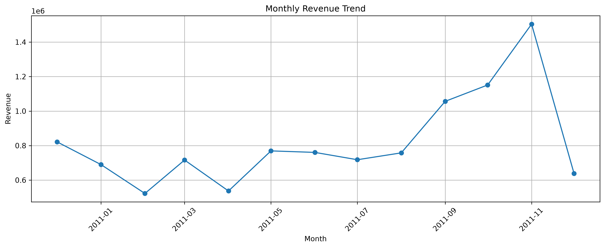
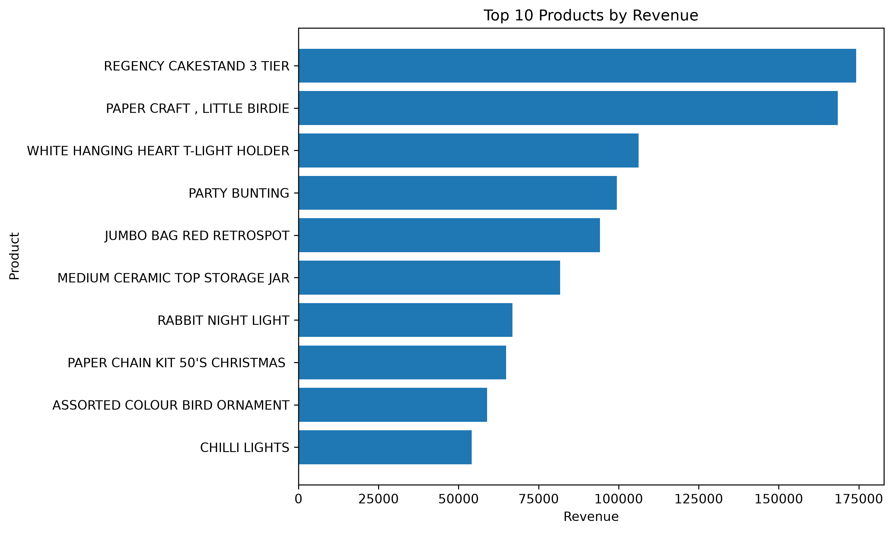
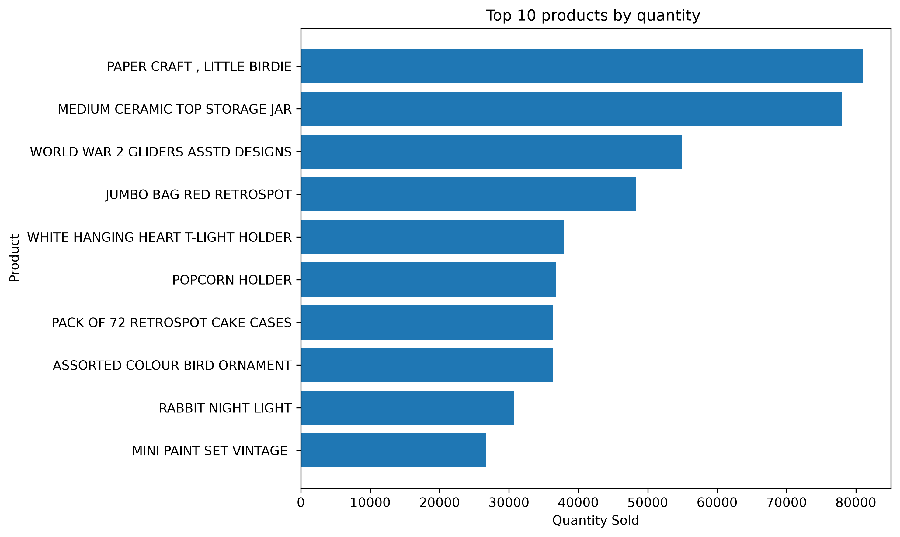
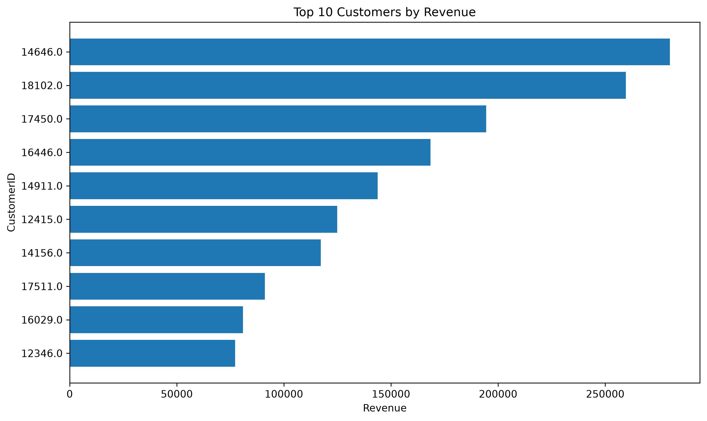
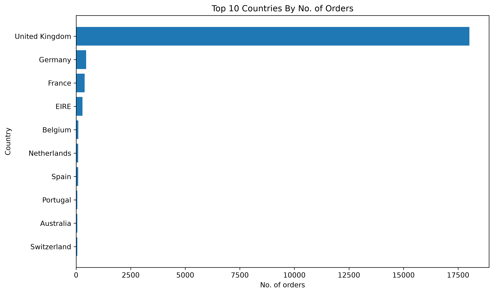

# E-commerce Sales Analysis | Exploratory Data Analysis (EDA)

##  Project Overview

This project focuses on exploring and analyzing an online retail dataset to understand sales performance, product demand, customer purchasing patterns, and country-wise revenue.

Using Python and its data analysis libraries, I cleaned the dataset, performed Exploratory Data Analysis (EDA), and created visualizations to identify useful business insights.

##  Objectives

* Clean and prepare the raw retail dataset.
* Analyze overall revenue and quantity sold.
* Identify monthly sales trends.
* Find the top-performing products by revenue and quantity.
* Analyze sales across different countries.
* Explore customer purchasing activity.
* Present findings through visualizations and business insights.


## Project Structure

```text

Ecommerce-sales-analysis/
├── E-commerce_Sales_Analysis.ipynb
├── Readme.md
├── sales_analysis.sql
├── monthly_revenue_trend.png
├── top_country_by_orders.png
├── top_customers_by_revenue.png
├── top_product_by_quantity.png
└── top_products_by_revenue.png

```

The notebook contains the Python data cleaning and
exploratory data analysis. The SQL file contains
queries for sales analysis, and the PNG files
contain the visualizations.


##  Dataset

The project uses the **Online Retail dataset**, which contains transactional records from a UK-based online retail business.

The original dataset contains approximately 541,909 records, covering transactions from December 2010 to December 2011.

Important columns include:

* `InvoiceNo`: Invoice number for each transaction.
* `StockCode`: Product code.
* `Description`: Product name or description.
* `Quantity`: Number of units purchased.
* `InvoiceDate`: Date and time of the transaction.
* `UnitPrice`: Price per unit.
* `CustomerID`: Customer identifier.
* `Country`: Customer's country.

##  Tools and Technologies

* **Python** — data analysis and programming.
* **Pandas** — data cleaning, manipulation, and aggregation.
* **NumPy** — numerical operations.
* **Matplotlib** — data visualization.
* **Seaborn** — statistical visualization.
* **Jupyter Notebook** — interactive analysis environment.

##  Project Workflow

### 1. Data Loading and Exploration

* Loaded the dataset into Pandas.
* Examined the dataset's structure, columns, data types, and summary statistics.
* Checked for missing and invalid values.

### 2. Data Cleaning

* Handled missing values where appropriate.
* Removed invalid transaction records based on the analysis criteria.
* Prepared the data for further analysis.

### 3. Exploratory Data Analysis

* Calculated revenue using quantity and unit price.
* Analyzed monthly revenue trends.
* Identified top products by revenue.
* Identified top products by quantity sold.
* Analyzed country-wise revenue.
* Examined customer purchasing activity.

### 4. Data Visualization

Created charts to make sales patterns and comparisons easier to understand, including:

* Monthly Revenue Trend.
* Top 10 Products by Revenue.
* Top 10 Countries by Revenue.
* Top 10 Customers by Revenue.
* Top 10 Products by Quantity Sold.


## Visualizations

### 1. Monthly Revenue Trend


### 2. Top Products by Revenue


### 3. Top Products by Quantity Sold


### 4. Top Customers by Revenue


### 5. Top Countries by Orders



### 5. Business Insights

Summarized important findings from the analysis to understand product performance, sales trends, and customer activity.

##  Key Findings

* The cleaned dataset contained **524,878 records**.
* The total calculated revenue was approximately **10.64 million currency units**.
* The total recorded quantity sold was **5,572,420 units**.
* November 2011 had the highest monthly revenue in the analysis.
* February 2011 had the lowest monthly revenue in the analysis.
* Regency Cakestand 3 Tier and Paper Craft, Little Birdie were among the highest-revenue product descriptions.

*These findings are based on the cleaning and calculation methods used in this project. Revenue is reported in dataset currency units without assuming a currency symbol.*

##  What I Learned

Through this project, I gained practical experience in:

* Loading and inspecting real-world datasets.
* Cleaning data using Pandas.
* Handling missing values and invalid records.
* Performing aggregation and grouping operations.
* Analyzing revenue, products, customers, and countries.
* Creating visualizations using Matplotlib and Seaborn.
* Interpreting data and communicating business insights.


## How to Run the Project

1. Download or clone this repository.
2. Download the Online Retail dataset from the
   [UCI Machine Learning Repository](https://archive.ics.uci.edu/dataset/352/online+retail).
3. Place the Excel dataset in your local project folder.
4. Install the required libraries:

   ```bash
   pip install pandas numpy matplotlib seaborn openpyxl
   ```

5. Open `E-commerce_Sales_Analysis.ipynb` in VS Code or Jupyter Notebook.
6. Update the dataset file path in the notebook if necessary.
7. Select your Python environment and run the notebook cells.
8. To explore the SQL analysis, open `sales_analysis.sql`
   in a text editor or SQLite-compatible SQL tool.

##  Future Improvements

* Perform more detailed customer segmentation.
* Analyze repeat purchasing and customer retention.
* Explore seasonal sales patterns in greater detail.
* Write SQL queries for additional analysis.
* Build an interactive sales dashboard.

##  Author

Created as a hands-on learning project to develop practical skills in Python, data analysis, and Exploratory Data Analysis (EDA).
